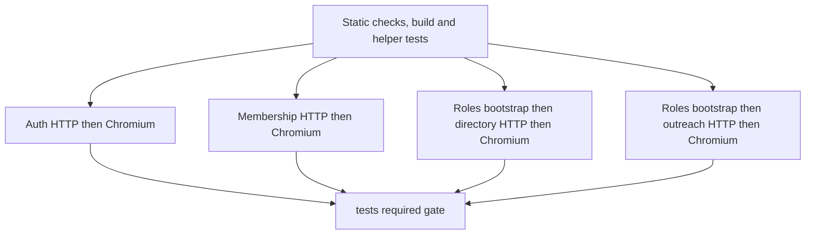

# CI testing and parallel integration contexts

The executable sources of truth are [the Tests workflow](../.github/workflows/tests.yml),
[the test runner](../scripts/test.mjs), and [Playwright configuration](../playwright.config.ts).
PR [#33](https://github.com/akbarsahata/alumni-platform/pull/33) introduces this layout.
Product acceptance coverage still uses real local Worker/D1/KV, Better Auth,
captured mail and Chromium with synthetic accounts.

## Stages and isolation



The first job runs formatting, advisory lint, typecheck, production build and
helper tests. Integration starts only after it succeeds. The build validates the
production bundle; integration jobs independently start the development Worker,
so they do not consume that build or share its artifacts.

Each matrix job has its own Ubuntu runner, Node 24, locked dependencies, Chromium
and system dependencies. It creates a fresh `.wrangler/integration-state-*`
directory with synthetic keys, matching origin configuration, D1 migrations and
KV state. A loopback mock Resend endpoint records provider requests for the real
introduction-attempt path; all other mail uses local capture. Its HTTP tests produce
the account/consent fixtures consumed by its browser tests. The Worker and mock
server are stopped and disposable state removed afterward. Normal development data
and `.dev.vars` are preserved.

Parallelism is between jobs. HTTP files run sequentially inside each context;
Chromium uses one worker. Directory and outreach first run `roles.test.mjs` to
create the shared `accounts.json` primary-administrator fixture. Splitting HTTP
and Chromium onto separate jobs would break these fixture dependencies without
an explicit replacement setup design. Persisted state contains synthetic sessions
and mailbox keys and is not transferred between jobs or uploaded as an artifact.

## Context ownership

Names below omit `tests/` and `.test.mjs` for HTTP, and `tests/browser/` and
`.spec.ts` for Chromium. Preserve the runner's HTTP order when changing a group.

| Context      | HTTP files in order                                                                                       | Chromium files                                                                                              |
| ------------ | --------------------------------------------------------------------------------------------------------- | ----------------------------------------------------------------------------------------------------------- |
| `auth`       | auth, logout                                                                                              | login                                                                                                       |
| `membership` | roles, membership, references, backend, corrections, account-bar, invitations, suspensions, email-changes | roles, membership, references, corrections, account-bar, invitations, suspensions, email-changes, hydration |
| `directory`  | profiles, directory, school-needs, representative-names                                                   | profiles, directory, school-needs, representative-names, navigation-preview                                 |
| `outreach`   | outreach, introductions, outcomes, clarification, deletion                                                | outreach, introductions, outcomes, clarification, deletion                                                  |

`location-list.test.mjs` and `email-delivery.test.mjs` are the helper suites, run by
the static job and by each runner invocation. The email suite exercises the Resend
adapter with a mocked provider and the introduction delivery orchestration without
live credentials. Roles setup repeats in directory and outreach. These repeated
checks must not be counted as additional distinct acceptance tests.

Before provisioning state, the runner compares all top-level `tests/*.test.mjs`
(except the helper suite) and `tests/browser/*.spec.ts` against the context map.
Missing, stale or duplicate assignments fail the invocation. When adding a test,
assign it in `scripts/test.mjs`; when adding a context, also update the workflow
matrix and this table. A newly added helper suite needs explicit runner support.

## Commands and operational limits

```sh
npm test
npm test -- --context auth
npm test -- --context membership
npm test -- --context directory
npm test -- --context outreach
node scripts/test.mjs tests/representative-names.test.mjs tests/browser/representative-names.spec.ts
```

Plain `npm test` retains the original full-suite ordering: sequential fixture
producers, followed by concurrent auth HTTP, logout HTTP and the full browser set.
Focused file arguments retain their existing behavior; choose a producer that
creates the browser fixture you need. Direct `npm run test:browser` does not
provision a Worker, migrations or fixtures.

Keep `127.0.0.1:5173` free. Separate GitHub runners can use that same port; local
context commands should run sequentially. Run typecheck/build separately from a
running test Worker because React Router generates shared route types in the
checkout. CI starts with a cold Vite cache. To reproduce first-navigation failures
locally, stop the test Worker, remove only generated `node_modules/.vite`, and rerun
the affected context. The existing `optimizeDeps.include` list explicitly includes
lazy-route validation (`zod`) and timestamp dependencies (`date-fns` and
`date-fns/locale`). Discovering them during a journey can invalidate imported
modules with `504 Outdated Optimize Dep` and prevent hydration. Keep this list
aligned with lazy client dependencies; do not hide such failures with test retries. Neither local hooks nor CI require live email or Cloudflare credentials.

## Failure and required-check behavior

The static and integration jobs each have a 15-minute timeout. This is a limit,
not an expected duration. Matrix `fail-fast: false` keeps sibling contexts running
when one fails. The final job is still named `tests`, uses `if: always()`, and
requires both the static result and aggregate matrix result to equal `success`.
Failed, cancelled or skipped prerequisites cannot produce a passing gate.
Existing branch protection can continue requiring `tests`; the workflow does not
change repository rules.

Events remain pushes to `master`, pull requests and merge queue groups. Feature
pushes without a PR and tag pushes do not run it. Newer runs do not cancel older
runs. See [local development](local-development.md#github-actions) for setup and
branch-protection instructions.

## Timing and browser diagnostics

The runner prints `[timing]` lines for commands. Use GitHub job/step timestamps
for elapsed workflow time, including runner scheduling, dependency installation,
Chromium installation and Worker readiness. Parallel jobs repeat setup, trading
more runner minutes for potentially shorter elapsed time. Compare equivalent
successful commits/runs before claiming a speedup; a failed fast run is not a
performance result.

OTP tests assert the persisted five-minute lifetime and age only disposable
verification rows before calling real HTTP endpoints. Rate-limit reset tests
similarly age persisted limiter rows. Neither requires a five-minute sleep.

Automatic traces, videos and screenshots are disabled in Playwright configuration.
Some journeys explicitly save private diagnostic screenshots under ignored
`test-results/`; those captures can still wait on external fonts. The
representative-name journey keeps workflow, captured-mail and mobile-width
assertions but no longer takes its two optional screenshots. A deliberately
stalled font reproduced its 30-second timeout, while the same probe passed in
2.3s after removing captures. Temporary fault injection was removed. Hosted logs
alone did not identify the exact original blocking step. That removal alone did not resolve the subsequent hosted directory timeout.
A second probe stalled the Google Fonts stylesheet and reproduced a timeout in
`page.goto` even without screenshots. The shared `useAccount` browser helper now
aborts requests to `fonts.googleapis.com` and `fonts.gstatic.com` once per context,
keeping these functional journeys independent of external font availability. The
representative-name journey retains an unavailable-font-host regression case;
its assertions still exercise the real Worker and local application assets.
Directory/outreach cleanup preserves original failures instead of replacing them
with context-close errors. No retries or longer test timeout were introduced.
Avoid making functional acceptance depend on optional screenshots or increasing
timeouts without diagnosis.

Current local/hosted delivery evidence belongs in [the handoff](handoff.md), not
in this operational contract.
